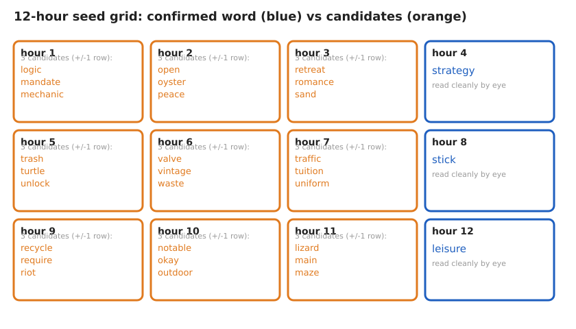

# LogicBeach: Powerful Moss (0.55 ETH, [SOLVED])

LogicBeach, an anonymous glitch and downtempo artist, released their 6th album, "Powerful
Moss," on 2025-01-17 with a prize contract on Base holding ETH that grows over time and pays
out to whichever wallet a 12-word BIP39 seed derives. This is the artist's 3rd treasure hunt in
the same format: the first 2, "Bifurcations" (2020, Bitcoin) and a 2021 Ethereum puzzle, both
paid out to real solvers. I confirmed the carrier for this one is not the audio, unlike
"Bifurcations": it is a POAP badge image showing a clock face laid over the full alphabetical
BIP39 wordlist as wrapped text, where each hour's numeral marks a word and the 12 hours give
the order. 3 of the 12 hours read with no ambiguity; the other 9 are pinned to about 3
candidate words each because a numeral spans roughly 2 text rows on the only resolution the
image exists at. Over 3.3 million candidate 12-word combinations have been tested against the
winner wallet, all negative, and no higher-resolution source of the image is known to exist.

## At a glance

| | |
|---|---|
| Author | LogicBeach, [logicbeach.xyz](https://logicbeach.xyz/powerfulmoss) |
| Published | 2025-01-17, album and NFT drop ([puzzle page](https://logicbeach.xyz/powerfulmoss)) |
| Prize | 0.55 ETH held by the prize contract (about $1,034 at ETH = $1,880, 2026-08-16) |
| Chain | base |
| Escrow | `0x831102C7eb86f9EC8f79dF891bDeA187D54344Dd` ([explorer](https://basescan.org/address/0x831102C7eb86f9EC8f79dF891bDeA187D54344Dd)) |
| Last on-chain check | 2026-10-18: Base prize contract balance 0; claimed 2026-10-05 17:27 UTC by the designated winner wallet, tx `0xae42fac9` |
| Status | SOLVED; prize claimed 2026-10-05, method not public |
| Puzzle type | image-stego, bip39-seed, word-selection, smart-contract |
| Target format | BIP39 12 words (English), BIP44 `m/44'/60'/0'/0/0`, no passphrase, address must equal the winner wallet |
| Certified oracle | yes: `tools/oracle.py --selftest` (certified against the public BIP39 KAT address and the artist's prior solved "Bifurcations" BIP84 vector) |
| What remains | nothing on-chain; the solving method is not public |
| Series | none |

## The puzzle as published

The album has 12 tracks, listed exactly as published in the NFT's own metadata in
`data/tracks.json`. The NFT unlocks a download link, but the album is also freely downloadable
from the puzzle page. A POAP badge tied to the launch, drop "PowerfulMoss By LogicBeach.eth" (drop
id 183468, created 2025-01-10), carries the puzzle's real artwork: a clock face with 12 serif
numerals laid over the complete alphabetical BIP39 wordlist rendered as wrapped monospace
text, plus a 24-ray red sunburst and a cursive signature. The prize contract's own getters
report a start time of 2025-01-17 20:00 UTC, a minimum claimable amount of 0.25 ETH, and a pot
that grows toward the contract's full balance over time; an early withdrawal forfeits the
remainder to the contract's creator. Full quotes and links in `clues/author-posts.md`.


*Figure 1. State of the seed grid by hour, confirmed versus candidate (source: data/seed-grid.json, script tools/fig_seed_grid.py), 2026-08-16.*

## What is understood

### Mechanism

12 BIP39 words, read off the POAP clock image in clock order, form a mnemonic that derives the
winner wallet under the standard Ethereum path `m/44'/60'/0'/0/0` (precedented by the artist's
2021 puzzle, which used the same path). The background of the POAP image is the full BIP39
wordlist in alphabetical order, wrapped as monospace text at a measured row pitch of 48 pixels
across 39 rows; the 12 clock numerals sit at measured centroid positions around a calibrated
center, and the word each numeral overlays is read as that hour's candidate word. The row a
numeral falls on can only be pinned to within 1 row on the published 2004x2011 raster, since the
numeral glyphs themselves span roughly 2 rows: this is a resolution limit of the only image that
exists, not a gap in the analysis.

### Derivation and oracle

```
python3 tools/oracle.py --selftest                 # must print SELFTEST OK
python3 tools/oracle.py "w1 w2 w3 w4 w5 w6 w7 w8 w9 w10 w11 w12"
python3 tools/oracle.py --stdin                     # one 12-word candidate per line
```

A candidate is validated as a BIP39 mnemonic, seeded, and swept across 9 nearby BIP44 paths (3
accounts times 3 indexes) to be anti-false-negative against a wallet imported at a non-default
account or index. It reports `MATCH <path> <address>` only on an exact match against the winner
wallet, `NO MATCH` otherwise.

### Certified against

`tools/oracle.py --selftest` reproduces the public BIP39 all-zero-entropy test vector at
`m/44'/60'/0'/0/0`, deriving `0x9858EfFD232B4033E47d90003D41EC34EcaEda94`; a positive control
confirms the oracle finds this same address when told to look for it; a negative control
confirms the same phrase does not match the real winner wallet; and an independent check
reproduces the artist's own solved "Bifurcations" seed at BIP84, deriving
`bc1qj7467e7r5pdfpypm03wyvguupdrld0ul2gcutg`, the address that received and fully spent 0.1058
BTC in that prior puzzle. Reproduced 2026-08-16.

### Established facts

1. The prize contract holds 0.55 ETH and the winner wallet remains at a dust balance with an
   unchanged outgoing transaction count, checked via `eth_getBalance` and
   `eth_getTransactionCount` against a public Base RPC endpoint on 2026-08-16. The pot grew
   from 0.54 to 0.55 ETH since the prior check, consistent with the contract's own time-based
   growth mechanism rather than a partial claim.
2. The prize is a contract balance, not a plain wallet: `eth_getBalance` must be read on the
   contract address, not on the winner wallet or the artist's separate `owner()` address, which
   controls minting and metadata only, not the pot.
3. The album's masters measure at close to 0 percent energy above 13 kHz, a property of the
   recording rather than a playback artifact, so the "Bifurcations" audio toolbox (which solved
   the artist's prior puzzle) finds nothing on all 12 tracks of this album: there is no high
   band left to carry spectrogram text.
4. The POAP clock image (`clues/powerfulmoss-poap.png`) is a single flow-text layer plus a
   decorative red-and-yellow vector overlay: a gray-intensity and hue histogram of the full
   image shows exactly 1 text-gray population and only 2 non-gray hue families, ruling out any
   distinctly marked word overlay.
5. No source of the plot finer than the published 2004x2011 raster is known to exist: checked
   against the prize contract's own `tokenURI`, the POAP asset server, the artist's website, and
   the album's video (1080p, lower resolution than the plot).
6. The artist's 2 prior puzzles in this format both paid out to real solvers: "Bifurcations"
   (2020) to `bc1qj7467e7r5pdfpypm03wyvguupdrld0ul2gcutg`, fully spent, and the 2021 ETH puzzle
   to a wallet now at 0 ETH, both confirmed on-chain.

## What has been tested

Full ledger in [analysis/tested.md](analysis/tested.md). Summary:

| Hypothesis | Space | Method | Result | Witness | Date |
|---|---|---|---|---|---|
| Full "Bifurcations" audio toolbox on all 12 lossless masters | 12 tracks | spectrogram, Morse, SSTV, LSB, ASR, source separation | 0 findings, high band physically empty | yes | 2026-06-17 |
| POAP grid enumeration, 4 canonical orderings, row window plus 1 | 1,193,373 combinations (132,597 checksum-valid) | BIP44 m/44'/60'/0'/0/0 plus neighbor sweep | 0 match | yes | 2026-07-14 |
| Asymmetric row window per ordering | 531,441 combinations per ordering | same oracle | 0 match | yes | 2026-06-17 |
| Wider row window refinement | about 8.6e8 estimated, sampled | same oracle | 0 match on sample | yes | 2026-06-17 |
| Distinct-overlay and higher-resolution-source hypotheses | full image | histogram analysis, source hunt | both refuted | yes | 2026-06-17 |

Cumulative: over 3.3 million candidate combinations tested against the winner wallet, 0
matches. Lyric tokens on 2 tracks were deliberately not fed to the oracle: no mechanism selects
which 12 of them would be the seed, so this is untested rather than negative.

## Open leads, ranked

1. **Re-run the grid enumeration at a wider row window, one doubtful hour at a time** (hours).
   Start with the hours clipped at the frame edge. Confirmed if an opened hour yields a match;
   killed for the numeral-overlay reading once every doubtful hour is widened with no match.
2. **Resample at the numeral's bottom pixel instead of its centroid** (minutes). A cheap
   re-measurement that changes the candidate set for some hours before repeating the same
   4-ordering sweep.
3. **Test the sunburst ray length as an alternative per-hour selector** (hours). The 24 rays
   have measurably varying length, never tested as a selection or ordering signal.

Full notes: [analysis/leads.md](analysis/leads.md).

## Solution

The Base prize contract was emptied on 2026-10-05 17:27:49 UTC: the designated winner wallet `0x635739254BDE27d28301f25aD57c3cAC3C3468f3` called the claim, [tx `0xae42fac9`](https://basescan.org/tx/0xae42fac96356a739ac387779d66d2386aad1cf868066ab58c7e23f661539f98f), and the contract balance is now 0. Reported in [issue #42](https://github.com/floflo777/open-crypto-puzzles/issues/42) by githumblebee; also recorded in the agntn/puzzles catalogue. No public solution or seed phrase was posted, so who claimed it and how the clock-and-grid was read is not known. If the solver reads this, a write-up gets full credit here.

## Files in this folder

| Path | What it is |
|---|---|
| `clues/powerfulmoss-poap.png` | the published POAP artwork, byte-exact, sha256 recorded in puzzle.json |
| `clues/author-posts.md` | the author's published NFT metadata and launch-period quote, dated and linked |
| `data/tracks.json` | the album's 12 track titles, exactly as published in the NFT metadata |
| `data/seed-grid.json` | the 12-hour seed grid state (confirmed words, candidate words) |
| `analysis/tested.md` | the complete negatives ledger |
| `analysis/leads.md` | full notes behind the 3 ranked leads |
| `images/01-seed-grid.svg` | the seed grid figure |
| `tools/oracle.py` | candidate checker, BIP44 path sweep, certified |
| `tools/fig_seed_grid.py` | generates images/01-seed-grid.svg from data/seed-grid.json |

## Sources

- LogicBeach, "Powerful Moss" puzzle page: https://logicbeach.xyz/powerfulmoss
- LogicBeach, launch-period tweet ("8 people have discovered the POAP"), 2025-01-24: https://x.com/Logic_Beach/status/1882824094854557885
- POAP drop "PowerfulMoss By LogicBeach.eth" (drop id 183468), checked 2026-08-16: https://poap.gallery/drops/183468
- "Bifurcations" solve write-up (prior puzzle, cited for method precedent, not part of this prize), checked 2026-08-16: https://elronvhubbard.medium.com/logic-beach-bifurcations-album-puzzle-write-up-1e1094d41038
- 2021 ETH puzzle write-up (prior puzzle, cited for method precedent, not part of this prize), checked 2026-08-16: https://l0gicbeach.medium.com/logicbeach-eth-album-puzzle-2021-57acaf1910db
- Prize contract, Basescan: https://basescan.org/address/0x831102C7eb86f9EC8f79dF891bDeA187D54344Dd
