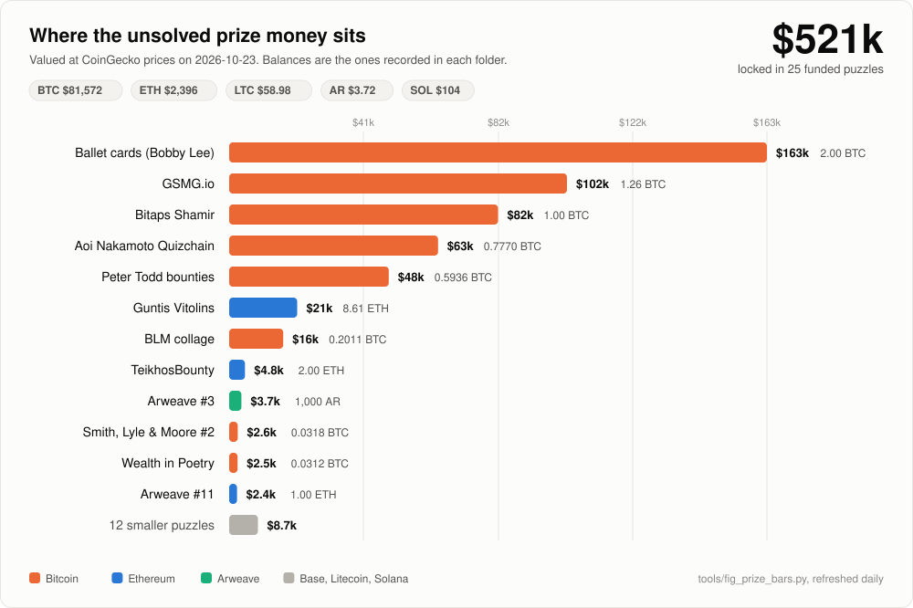

# open-crypto-puzzles

Someone hides a crypto wallet inside a puzzle, publishes the address, and dares the internet
to solve it and keep what is in it. These are real, still unsolved, and the coins are sitting
on-chain right now.

## Still unsolved, sitting on-chain

*The chart is regenerated every day at live CoinGecko prices by a scheduled job; the balances are the ones recorded in each folder and re-checked with `tools/check_escrows.py`.*

*The biggest unsolved prizes on-chain right now. Regenerated from the manifests by `tools/fig_readme_totals.py`.*

<!-- totals:start -->
| Asset | Locked in unsolved puzzles | Approx. value |
|---|---|---|
| Bitcoin | 5.94 BTC | $374,000 |
| Ethereum | 12.66 ETH | $24,000 |
| Arweave | 1,500 AR | $2,700 |
| Litecoin | 3.03 LTC | $200 |
| Stablecoins | 306 USDT + 0 USDC | $300 |
| **Total** | **across 25 funded puzzles** | **$401,000** |

Checked 2026-08-16 at BTC $63,000, ETH $1,880, AR $1.81. Prices and balances move; verify each escrow yourself.
<!-- totals:end -->

I am floflo777. I worked about 40 of these and solved a few (0.5 ETH and about 0.01 BTC).
This is my research on the rest: for every puzzle, the address, the author's clues, what I
tried, and where I got stuck. Pick one and keep going.

## How to read this repository

1. Pick a tier below. Prizes are grouped by USD value at the snapshot date.
2. Open the puzzle folder. `README.md` is the whole story: clues, mechanism, tested, leads.
3. Before any effort, re-check the escrow yourself: click the explorer link in "At a glance"
   or read [docs/verify-funding.md](docs/verify-funding.md). The chain is the truth, not this file.
4. `analysis/tested.md` is what not to redo. `analysis/leads.md` is where to start.
5. If you solve one: sweep first, then tell people. See [CONTRIBUTING.md](CONTRIBUTING.md).

## How to use it with an AI agent

Point your agent (Claude Code, Codex, Cursor, or any other) at [AGENTS.md](AGENTS.md). It
contains the rules and a starter prompt. The machine-readable index is
[puzzles.json](puzzles.json); each folder has a `puzzle.json` and, when the derivation is
known, `tools/oracle.py --selftest`.

## Engines

The GPU and CPU bruteforce engines I use on these puzzles are in [engines/](engines/): a
checksum-aware BIP39 seed and passphrase kernel (about 790k derivations/s), a brainwallet
`SHA256 -> secp256k1 -> hash160` kernel (about 9.3M keys/s), an Electrum v1 old-seed engine,
and two Arweave key-stretch engines. They ship as CUDA source plus Python host drivers with
self-tests; build them with `engines/build.sh` (nvcc), then point one at a puzzle's target.
See [engines/README.md](engines/README.md).

## Start here: eleven to look at first

If you do not know where to begin, these eleven are the clearest to pick up. The full list,
grouped by prize, is in the tables below.

| Puzzle | Prize | Why it is a good place to start |
|---|---|---|
| [Keir Finlow-Bates: book treasure hunt](2-mid-prizes/keir-finlow-bates-blockchain-book-600ksats/) | 600,000 sats open, 4 lots solved | I solved 4 of its 12 lots; the write-ups show exactly how the author hides a key, which is the strongest lead for the 3 still open. |
| [Corey Phillips: kitten passphrase](2-mid-prizes/corey-phillips-kitten-passphrase-1msats/) | 0.01 BTC | The seed is fixed and public; only one BIP39 passphrase is missing. A clean, bounded target to point a tool at. |
| [GSMG.io puzzle](1-big-prizes/gsmg-io-5btc-puzzle/) | 1.25 BTC | A famous multi-stage hunt; every stage but the last is solved. The final gate is two sealed AES blobs. |
| [Guntis Vitolins MetaMask seed](1-big-prizes/guntis-vitolins-metamask-8-6eth/) | 8.61 ETH | The largest prize here. A 12-word seed scattered across the author's own clues. |
| [Ballet / Bobby Lee cards](1-big-prizes/ballet-bobby-lee-2btc-cards/) | 2 BTC | Two physical Ballet cards, 1 BTC each. Each needs one hidden half that was never photographed. |
| [Aoi Nakamoto Quizchain](1-big-prizes/aoi-nakamoto-quizchain-0-854btc/) | 0.854 BTC | The key comes from a Wattpad chapter run through MD5. The rule is certified on a solved sibling block. |
| [BLM collage seed](1-big-prizes/blm-brave-new-world-0-2btc/) | 0.2 BTC | A whole seed hidden inside one large collage image: runes, micro-text, a clock. |
| [Arweave Puzzle #11](2-mid-prizes/arweave-puzzle-11-1eth/) | 1 ETH | A single grayscale sketch that encodes a raw 64-hex private key. |
| [Smith, Lyle & Moore Hunt #2](2-mid-prizes/smith-lyle-moore-hunt-2-0-032btc/) | 0.032 BTC | A tree of password-locked web pages; each page you open hands you a fragment of the seed. |
| [Path to Greatness: Treasure Hunt](2-mid-prizes/path-to-greatness-treasure-hunt-3ltc/) | 3.03 LTC | The author drew his own encryption on one of the clue images: four independent two-answer locks, each with an exact test, so a guess is settled in microseconds. |

<!-- generated:start -->
## Big prizes (>= $10,000)
| Puzzle | Prize | USD | Chain | Type | What remains | Escrow checked | Status |
|---|---|---|---|---|---|---|---|
| [Ballet / Bobby Lee: Take Bobby's Bitcoin](1-big-prizes/ballet-bobby-lee-2btc-cards/) | 2.00007358 BTC | 126,005 | bitcoin | bip38, physical-object | external-info | 2026-08-16 | open |
| [GSMG.io Puzzle](1-big-prizes/gsmg-io-5btc-puzzle/) | 1.2563451 BTC | 79,150 | bitcoin | text-cipher, pixel-code, web-tree, raw-private-key | insight | 2026-09-03 | open |
| [Bitaps Shamir Secret Sharing Challenge](1-big-prizes/bitaps-shamir-challenge-1btc/) | 1.00016775 BTC | 63,011 | bitcoin | shamir, bip39-seed | external-info | 2026-08-28 | open |
| [Aoi Nakamoto Quizchain](1-big-prizes/aoi-nakamoto-quizchain-0-854btc/) | 0.777 BTC | 48,951 | bitcoin | bip39-seed, word-selection | external-info | 2026-08-27 | open |
| [Peter Todd Hash Collision Bounties](1-big-prizes/peter-todd-hash-collision-bounties-0-59btc/) | 0.59364885 BTC | 37,400 | bitcoin | hash-collision | research-breakthrough | 2026-08-16 | watch |
| [Guntis Vitolins: 10 ETH Challenge](1-big-prizes/guntis-vitolins-metamask-8-6eth/) | 8.612541554256945 ETH | 16,192 | ethereum | bip39-seed, word-selection, video-series | bounded-compute | 2026-08-16 | open |
| [BLM Collage: Welcome to the Brave New World](1-big-prizes/blm-brave-new-world-0-2btc/) | 20,107,284 sats | 12,668 | bitcoin | image-stego, word-selection, bip39-seed, text-cipher | insight | 2026-08-16 | open |

## Mid prizes ($100 to $10,000)
| Puzzle | Prize | USD | Chain | Type | What remains | Escrow checked | Status |
|---|---|---|---|---|---|---|---|
| [TeikhosBounty: Johan Nygren's Proof-of-Public-Key Puzzles](2-mid-prizes/teikhos-bipedaljoe-solver-bounties-2eth/) | 2.000006 ETH | 3,760 | ethereum | smart-contract, timelock | external-info | 2026-08-16 | open |
| [Smith, Lyle & Moore Hunt #2: Glimmer](2-mid-prizes/smith-lyle-moore-hunt-2-0-032btc/) | 0.031777 BTC | 2,002 | bitcoin | bip39-seed, password-pages, web-tree | insight | 2026-08-16 | open |
| [Trithemius: Wealth in Poetry](2-mid-prizes/wealth-in-poetry-0-03btc/) | 3,124,630 sats | 1,969 | bitcoin | bip39-seed, text-cipher, brainwallet | insight | 2026-08-16 | open |
| [Arweave Puzzle #11](2-mid-prizes/arweave-puzzle-11-1eth/) | 1 ETH | 1,880 | ethereum | image-stego, pixel-code, raw-private-key | insight | 2026-08-16 | open |
| [Bountiful: the Fe compiler bug bounty](2-mid-prizes/fe-lang-bountiful-compiler-bounty-1eth/) | 1 ETH | 1,880 | ethereum | smart-contract, timelock | insight | 2026-08-17 | open |
| [Arweave Puzzle #3](2-mid-prizes/arweave-puzzle-3-1000ar/) | 1,000.165838006237 AR | 1,810 | arweave | word-selection, text-cipher | insight | 2026-09-04 | open |
| [Arweave Puzzle #10](2-mid-prizes/arweave-puzzle-10-500ar/) | 500.02225493 AR | 905 | arweave | word-selection, text-cipher | insight | 2026-08-16 | open |
| [Corey Phillips: Kitten Passphrase Puzzle](2-mid-prizes/corey-phillips-kitten-passphrase-1msats/) | 1,001,900 sats | 631 | bitcoin | bip39-seed, brainwallet | external-info | 2026-08-16 | open |
| [RushWallet Contest #30](2-mid-prizes/rushwallet-contest-30-1msats/) | 1,000,000 sats | 630 | bitcoin | brainwallet, audio | external-info | 2026-08-16 | open |
| [School of Bitcoin: 1 Million Sats In This Image](2-mid-prizes/school-of-bitcoin-1msats/) | 1,000,000 sats | 630 | bitcoin | bip39-seed, image-stego, password-pages | external-info | 2026-08-16 | open |
| [AH White: Walking Banks](2-mid-prizes/ah-white-walking-banks-800ksats/) | 800,000 sats | 504 | bitcoin | bip39-seed, book, text-cipher | external-info | 2026-08-16 | open |
| [Keir Finlow-Bates: Move Over Brokers Treasure Hunt](2-mid-prizes/keir-finlow-bates-blockchain-book-600ksats/) | 600,000 sats | 378 | bitcoin | book, brainwallet, text-cipher | human-action | 2026-09-01 | open |
| [FTPK Season 2: Never-Ending](2-mid-prizes/ftpk-season-2-300usdt/) | 305.930218 USDT | 306 | ethereum | bip39-seed, word-selection | insight | 2026-08-27 | open |
| [Zden Level HALV](2-mid-prizes/zden-haluska-halv-312ksats/) | 312,500 sats | 197 | bitcoin | geometry, raw-private-key | external-info | 2026-08-16 | open |
| [Path to Greatness: Treasure Hunt](2-mid-prizes/path-to-greatness-treasure-hunt-3ltc/) | 3.02608794 LTC | 163 | litecoin | raw-private-key, image-stego, audio, text-cipher | insight | 2026-09-12 | open |
| [Pindar Van Arman: cryptoArtGAN Act 1 Puzzle](2-mid-prizes/pindar-van-arman-cryptoartgan-nft/) | 1 NFT |  | ethereum | bip39-seed, word-selection | insight | 2026-08-16 | open |

## Small prizes (< $100)
| Puzzle | Prize | USD | Chain | Type | What remains | Escrow checked | Status |
|---|---|---|---|---|---|---|---|
| [Crypto Puzzles 2018: Puzzle #2](3-small-prizes/crypto-puzzles-2018-puzzle-2-0-05eth/) | 0.05 ETH | 94 | ethereum | raw-private-key, image-stego, video-series | external-info | 2026-08-16 | open |
| [Exitonly Bitcoin Challenge 14](3-small-prizes/exitonly-challenge-14-30ksats/) | 30,000 sats | 18.90 | bitcoin | bip39-seed, word-selection | uneconomic | 2026-08-16 | open |

## Solved and cashed
| Puzzle | Cashed | Payout tx | Date | Series lesson |
|---|---|---|---|---|
| [LogicBeach: Powerful Moss](4-solved/logicbeach-powerful-moss-0-54eth/) | 0.55 ETH | [0xae42fac96356a739ac387779d66d2386aad1cf868066ab58c7e23f661539f98f](https://basescan.org/tx/0xae42fac96356a739ac387779d66d2386aad1cf868066ab58c7e23f661539f98f) | 2026-10-05 | the carrier (the POAP clock image, not the audio), the order (clock position), and the derivation path are all confirmed; 3 of 12 hours read with no ambiguity and over 3.3 million combinations of the rest have been tested negative; the blocker is a resolution limit on the only known copy of the image (a numeral spans about 2 text rows, so 9 of 12 hours carry about 3 candidate words each), not raw compute, so an unrecovered insight into the exact readout rule or a finer source is what remains |
| [Arweave Puzzle Weave #12](4-solved/arweave-puzzle-12-400ar/) | 398.75 AR | [gx0Ws1TPZhmgTRk6j6UjMuaHiX4vYvfoqjzzW6Os7wo](https://viewblock.io/arweave/tx/gx0Ws1TPZhmgTRk6j6UjMuaHiX4vYvfoqjzzW6Os7wo) | 2026-10-04 | mechanism and oracle fully certified; piece 3 is solved with certainty, piece 1 has a strong unconfirmed reading, piece 4's hatching is refuted as an ordering scheme; the open gap is piece 2's exact 18-character string once the other 3 pieces are fixed |
| [Wonderabbit: Prometheus](4-solved/wonderabbit-prometheus-1msats/) | 1030810 sats | [2f5f60f69779e32c87829203d000ebfe5fbf6dd82707a560d7f252d3b462365c](https://mempool.space/tx/2f5f60f69779e32c87829203d000ebfe5fbf6dd82707a560d7f252d3b462365c) | 2026-09-28 | the encoding rules are fully published by the author, but the companion puzzle programme that turns those rules into an actual 12-word phrase has never appeared online; nothing is computable until it is obtained |
| [CaesarCoder: Genesis Block Wallet Puzzle](4-solved/caesarcoder-genesis-block-wallet-puzzle-947ksats/) | 935266 sats | [1c70c4745fad5bf891b9ee2a9f8b0b5cd3f328eb847eb09c9bebb92f5f7e900b](https://mempool.space/tx/1c70c4745fad5bf891b9ee2a9f8b0b5cd3f328eb847eb09c9bebb92f5f7e900b) | 2026-10-17 | swept on 2026-10-17; the answer was the coinbase text hex with passphrase Satoshi Nakamoto, already inside the standard searches, but with PBKDF2 at 181505 and 200913 rounds instead of 2048 |
| [Zden Cryptopuzzle LVL.5](4-solved/zden-haluska-lvl5-555ksats/) | 551745 sats | [e2544433184d0fe4157ca10a8e1ce753bb52a7b0bbcf833740d7448ed25e8e8e](https://mempool.space/tx/e2544433184d0fe4157ca10a8e1ce753bb52a7b0bbcf833740d7448ed25e8e8e) | 2026-09-22 | the rectangle geometry is certified byte-perfect and the hint formula is read at the pixel level; over 545 million candidate keys across 3,200-plus readings have produced zero matches; the blocker is the exact meaning of 3 undefined terms in the author's own hint, not computation |
| [Andy Bauch: New Money, COG](4-solved/andy-bauch-new-money-cog-428ksats/) | 427072 sats | [230bba19d8e60803f36cb88f428c20dcc88fb431e0f611ddb05d3432fa8c5947](https://mempool.space/tx/230bba19d8e60803f36cb88f428c20dcc88fb431e0f611ddb05d3432fa8c5947) | 2026-09-25 | the general encoding method is understood and 2 of its known variants are ruled out for COG with witnessed negatives; the blocker is image fidelity (whether individual brick seams are visible), and the physical piece is held by a private collector who bought it in 2018, not the artist |
| [VeteranHODL: Hunting Time](4-solved/veteranhodl-hunting-time-420ksats/) | 420000 sats | [d3783a1cde2c491a6edfbead81aeebda90257c8c25b4b0c9b2bac89bc5cd607a](https://mempool.space/tx/d3783a1cde2c491a6edfbead81aeebda90257c8c25b4b0c9b2bac89bc5cd607a) | 2026-08-18 | solved by a reader after publication, not by me |
| [Keysa: Crack the Seed Game](4-solved/keysa-crack-the-seed-369ksats/) | 369150 sats | [d072de42a72e5dd75f5eb4776f32eb26727ce37c5f7d54ee94c74347ed4eb2d7](https://mempool.space/tx/d072de42a72e5dd75f5eb4776f32eb26727ce37c5f7d54ee94c74347ed4eb2d7) | 2026-09-08 | swept on 2026-09-08 (block 966,260, 369,150 sats to bc1q82gz5dnpxnqmvzrkusm8yc0nt4dcqp8gd3y59j); the author confirmed the crack on X on 2026-09-10 without naming the solver; neither the 12 words nor the selection rule has been published; the negatives ledger stays as a record of what the selection rule is not |
| [FTPK Season 4: Something in Common](4-solved/ftpk-season-4-166usdc/) | 181 USDC | [0x4c10674a4856cbba9b66543cc027a77e6b3a1ba458085f8fe680d588ffdd8f37](https://etherscan.io/tx/0x4c10674a4856cbba9b66543cc027a77e6b3a1ba458085f8fe680d588ffdd8f37) | 2026-08-20 | solved by a reader after publication, not by me |
| [bc1q21 Time-Lock Challenge, Level 5](4-solved/bc1q21-timelock-challenge-l5-100ksats/) | 99604 sats | [73baf40f668fb221b6b9c934f199a51f7e0ab1f1bb585e07c18a7b3e88dfd7ed](https://mempool.space/tx/73baf40f668fb221b6b9c934f199a51f7e0ab1f1bb585e07c18a7b3e88dfd7ed) | 2026-07-24 | solved; the claim transaction confirms the answer |
| [Bitcoin Movie Enigma](4-solved/bitcoin-movie-enigma-100ksats/) | 99766 sats | [bd3b088164ae32458b97b917af8fab14056461c5e954499f7bd4cf3a67d6c5f4](https://mempool.space/tx/bd3b088164ae32458b97b917af8fab14056461c5e954499f7bd4cf3a67d6c5f4) | 2026-09-07 | solved by a reader (rabbidbird) after publication, not by me; the winning 24-word phrase fails the BIP39 checksum, so every checksum-filtered sweep, mine included, had discarded it |
| [LuckyLurker Seed Riddles](4-solved/luckylurker-seed-riddles-80ksats/) | 80000 sats | [75e570a5ea243c492e2804916482f046b2392b463c51be15624e6e25a84119f7](https://mempool.space/tx/75e570a5ea243c492e2804916482f046b2392b463c51be15624e6e25a84119f7) | 2026-08-17 | solved by a reader after publication, not by me |
| [Dug's Student Treasure Hunt (2025 edition)](4-solved/dug-student-treasure-hunt-63ksats/) | 59916 sats | [ee70de514686588173b64fc31fc317ae15f1e903c742cc99140d2cf1bb2e8db1](https://mempool.space/tx/ee70de514686588173b64fc31fc317ae15f1e903c742cc99140d2cf1bb2e8db1) | 2026-08-02 | solved; the payout transaction confirms the answer |
<!-- generated:end -->

Puzzles that turned out swept, unfunded, custodial, or fake are kept off the lists above, in
[archive/dead-ends/](archive/dead-ends/), for anyone curious about the ones that did not pan out.

## Series

- Arweave puzzles: #3, #10, #11, #12 open; #8 solved by others is the oracle calibration.
- Zden (crypto.haluska.sk): LVL5 and HALV open; earlier levels solved by others.
- FTPK: seasons 2 and 4 open; seasons 1 and 3 finished and still playable, used to learn the author's grammar.
- Finlow-Bates "Blockchain book": 12 lots, 3 open, 4 solved by me, 5 by others.
- Aoi Nakamoto Quizchain: Real Big Block and Block 76 open; Block 77 Stage One reproduced.

## On-chain check policy

Every address in this repository was checked within 30 days before publication; the date is
in each table and each `puzzle.json`. Prices and balances move. Run
`python3 tools/check_escrows.py` for a fresh table, or open the explorer links. If you find a
drift, open an issue with the txid.

## Method, in short

Oracle first: reproduce a known-good vector before searching. A negative counts only with a
witness. A solution is an exact match, character for character. Insight over compute: if a
run needs hours, the constraint has not been found yet. Details: [docs/methodology.md](docs/methodology.md).

## Disclaimer

These are public puzzles. Each reward was funded and published by the puzzle's own author,
who invited the public to solve it and take it. Nothing here targets a third party's wallet,
lost keys, or private data. Solving one of these puzzles is what the author asked for. I do
not guarantee that any escrow is still funded when you read this: check the chain. I am not
affiliated with any puzzle author. Do not send funds to any address in this repository.

## License and third-party material

Text, data tables and illustrations I made: [CC BY 4.0](LICENSE). Code under `tools/` and
`*/tools/`: [MIT](LICENSE-CODE). Puzzle images and short quotes remain the property of their
authors; they are reproduced as published because they are the challenge itself. Books,
audiobooks and articles are not reproduced; each folder links to where to find them.

## Contact

X: [@0xFlorent_](https://x.com/0xFlorent_). Issues on this repository for corrections, solves, and new leads.
